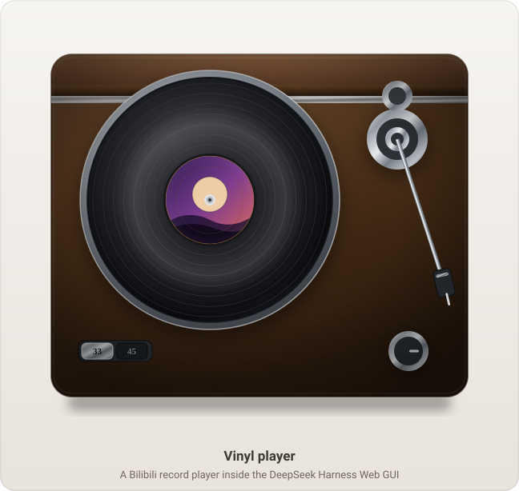
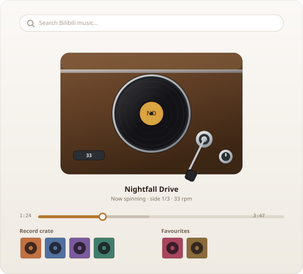

<div align="center">

# Vinyl player

**A cartoon turntable for Bilibili audio, living inside the DeepSeek Harness Web GUI.**

Search for music · drop a record on the platter · keep listening while you work

[](LICENSE)
[](https://github.com/topics/dsh-plugin)
[](package.json)



[简体中文](README.md) · **English**

</div>

---

## What it is

A record player, not a music app. There is no list of files, no playlist sidebar,
no transport bar full of buttons — there is a **turntable**. You search for a song,
a record appears in a crate, you drag that record onto the platter, and it plays.

The whole panel is drawn as an illustration: a wooden cabinet, a spinning black
disc with a paper label, a chrome tonearm, a speed selector and a volume knob. It
is meant to feel like a small object sitting on your desk rather than another tab.

And because the audio lives outside the panel, **you can close the panel and the
music keeps playing** while you work elsewhere in the app.

## The panel

<div align="center">

| Turntable | Records |
| :--: | :--: |
|  |  |

*Left: the deck itself. Right: how the panel is arranged.*

</div>

The deck is the centre of the panel. Underneath it sit two shelves:

- the **record crate** — whatever your last search turned up
- the **favourites shelf** — the records you kept

Hover a sleeve and it swells toward you. Drag it onto the platter and it plays.
Drag it onto the favourites shelf and it is collected.

## The tonearm is the transport

There is no play button on the deck. To play, **drag the tonearm onto the record**.
To pause, **lift it back onto its rest**. The arm follows your pointer around its
pivot, and it works from the keyboard too.

This is the whole interaction, and it is why the panel has no transport bar: the
gesture that starts the music is the gesture a real turntable uses.

Secondary controls — previous, stop, replay, next — sit underneath, along with a
progress bar you can drag. The grey band ahead of the thumb shows how much of the
track is already buffered.

## Features

| | |
| --- | --- |
| **A drawn, not assembled, interface** | Every part of the deck is vector artwork: gradients for the brushed metal and the vinyl sheen, a real paper label, a perspective-free front view. |
| **Drag as the only verb** | Drag to play, drag to collect, drag to scrub. No settings panel, no menus. |
| **Playback that outlives the panel** | Close the panel, keep the music. The sidebar entry keeps the current record in view. |
| **A crate and a shelf** | Search results become sleeves; the ones you keep get their own shelf and survive a reload. |
| **Honest buffering** | The progress bar shows played, buffered, and not-yet-loaded as three separate bands. |
| **Both languages** | 简体中文 and English, following the app's locale. |
| **Nothing written to disk** | Audio is streamed and released the moment you change track. |

## Install

Two ways. Neither needs a registry package: this plugin is distributed from its
repository.

### 1. Ask an agent to install it

In a DeepSeek Harness conversation, say:

```
安装 https://github.com/ChiaquanLin/dsh-plugin-vinyl-player 插件
```

The agent installs the bundle and reloads the panel, and the turntable appears in
the sidebar. This is the intended path — no terminal required.

### 2. Install with `dsh`

`dsh plugin` forwards to the profile's package manager, and **`--profile` is
required**, placed between `plugin` and the subcommand:

```bash
dsh plugin --profile desktop add github:ChiaquanLin/dsh-plugin-vinyl-player
```

Use the profile you actually run — `desktop` for the desktop app, `web` for
`dsh web`. To install from a local checkout instead:

```bash
git clone https://github.com/ChiaquanLin/dsh-plugin-vinyl-player
dsh plugin --profile desktop add ./dsh-plugin-vinyl-player
```

Adding the dependency also registers the bundle, so no separate enable step is
needed. Check or undo it with:

```bash
dsh plugin --profile desktop list
dsh plugin --profile desktop remove dsh-plugin-vinyl-player
```

### Afterwards

Reload the Web GUI. A **黑胶唱片机 / Vinyl player** entry appears in the sidebar;
open it and you have a turntable.

Requirements: a DeepSeek Harness Web GUI profile, and a network path to
`bilibili.com`. Node 20+ is only needed to run the tests.

Installing into a profile affects every session in that profile, and the plugin
survives a restart.

## Using it

| Do this | And this happens |
| --- | --- |
| Type in the search box | The crate fills with records |
| Click a sleeve | It plays |
| Drag a sleeve onto the platter | It plays |
| Drag a sleeve onto the favourites shelf | It is collected, without playing |
| Drag the tonearm onto the record | Play |
| Drag the tonearm back to its rest | Pause |
| Drag the progress bar | Scrub through the track |
| Click the heart on a sleeve | Keep it, or let it go |

## How it fits together

The bundle has two halves, and they exist because a browser cannot talk to
Bilibili directly.

**The host half** does the talking: it obtains an anonymous visitor cookie, signs
its requests, and exposes four endpoints the panel can call — search, resolve a
video's track list, resolve a playable stream, and proxy artwork. Audio itself is
proxied through the host too, so range requests work and nothing is cached.

**The client half** is everything you see: the deck, the shelves, the drag and drop,
and a small shared store that keeps the sidebar and the panel in agreement.

```
index.js              Host half — Bilibili client, routes, media proxy
lib/client.js         Client half — the panel, the deck, the store
cordis.patch.yml      Registers the plugin with the harness
locale/{en,zh}.json   Panel strings
icon.svg              Sidebar icon
docs/*.svg            The images in this README
tools/*.mjs           Test suites
```

## Tests

```bash
node tools/count-checks.mjs   # run every suite, 17 suites / 375 checks
node tools/e2e-probe.mjs      # optional: drives a real headless Edge
```

There are no dependencies to install — the suites use only Node's standard
library. The offline ones render the real components with a stub React and inspect
the result, which is how the deck's geometry is verified: every disc is asserted to
be a `<circle>`, the cabinet is asserted to contain its platter, and the tonearm's
stylus is asserted to land where it should. The browser probes cover what static
checks cannot see, such as how a real media element responds to a seek.

`node tools/count-checks.mjs --write` updates the totals quoted in this file, so
they cannot drift from the suites that produce them.

## Legal

This is an unofficial project. It is not affiliated with, endorsed by, or
sponsored by Bilibili, and it contains no audio, video, or artwork — everything
played is streamed at runtime from Bilibili's own servers.

It does not bypass paywalls, DRM, or access controls, and it writes nothing to
disk. You are responsible for complying with Bilibili's terms of service and with
the copyright law of your jurisdiction. For personal, lawful listening only.

Please read [LEGAL.md](LEGAL.md) before using it.

## Licence

[MIT](LICENSE) © ChiaquanLin

---

<div align="center">
<sub>Issues and pull requests welcome. See <a href="CONTRIBUTING.md">CONTRIBUTING.md</a> and <a href="SECURITY.md">SECURITY.md</a>.</sub>
</div>
