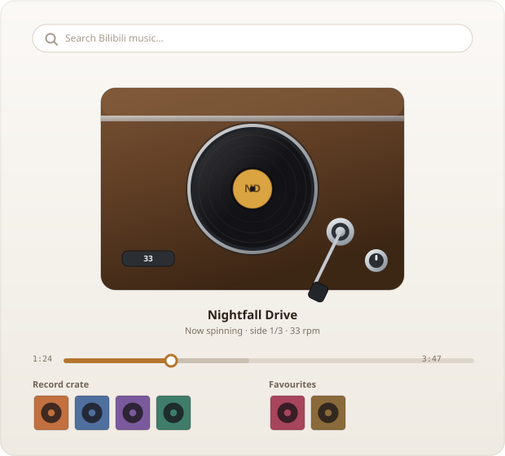

<div align="center">

# 黑胶唱片机

**一个跑在 DeepSeek Harness Web GUI 里的卡通黑胶唱机，用来听 Bilibili 的音乐。**

搜一首歌 · 把唱片放上唱盘 · 切到别处照样能听

[](LICENSE)
[](https://github.com/topics/dsh-plugin)
[](package.json)


**简体中文** · [English](README.en.md)

</div>

---

## 这是什么

它是一台唱机，不是一个音乐 App。

没有文件列表，没有播放列表侧栏，也没有一排放满按钮的播放条——只有一台**唱机**。你搜一首歌，唱片箱里出现一张唱片，你把这张唱片拖到唱盘上，它就开始放。

整个面板是画出来的：木质机箱、旋转的黑色唱片配一张纸质标签、一根镀铬唱臂、一个调速开关和一个音量旋钮。它更想让你觉得这是桌面上摆着的一个小物件，而不是又一个标签页。

而且因为音频不在面板里，**你可以关掉面板，音乐照旧继续播**，你在应用别处做事不受影响。

## 面板长什么样

<div align="center">

| 唱机 | 唱片 |
| :--: | :--: |
|  |  |

*左：唱机本体。右：面板的整体排布。*

</div>

唱机位于面板正中。下方并排两个架子：

- **唱片箱**——上一次搜索的结果
- **收藏架**——你留下来的唱片

鼠标悬停在唱片封套上，它会朝你微微涨大。把它拖到唱盘上，音乐响起；拖到收藏架上，它就归你所有。

## 唱臂就是播放键

唱机上没有播放按钮。想开始，**把唱臂拖到唱片上**；想暂停，**把它抬回唱臂架**。唱臂会跟着指针绕着枢轴转动，用键盘也能操作。

这就是全部交互，也正因为如此，面板上没有播放条——开始放音乐的那个动作，和真实唱机上的动作是同一个。

次级的控制——上一首、停止、重播、下一首——放在唱机下方，旁边是一条可拖动的进度条。滑块前方那段灰色区域表示已经缓冲好的部分。

## 功能

| | |
| --- | --- |
| **画出来的界面，不是拼起来的** | 唱机的每一部分都是矢量图形：拉丝金属和黑胶光泽用渐变表现，有一张真正的纸质唱片标签，正面视角不做透视。 |
| **只有「拖」这一个动词** | 拖动来播放、拖动来收藏、拖动来快进。没有设置面板，没有菜单。 |
| **播放比面板活得更久** | 关掉面板，音乐不停。侧边栏的入口会一直显示当前这张唱片。 |
| **一个箱子，一个架子** | 搜索结果变成一张张封套；你留下的那些有自己的架子，重载后还在。 |
| **诚实的缓冲显示** | 进度条用三段分别表示已播放、已缓冲、尚未加载。 |
| **中英双语** | 简体中文与 English，跟随应用的界面语言。 |
| **不写磁盘** | 音频边播边取，切换唱片的那一刻就释放。 |

## 安装

两种方式，都不需要发布到任何包仓库——这个插件直接从仓库分发。

### 1. 让智能体帮你装

在一个 DeepSeek Harness 对话里说：

```
安装 https://github.com/ChiaquanLin/dsh-plugin-vinyl-player 插件
```

智能体会把 bundle 装上并重新加载面板，侧边栏里就出现唱机了。这是推荐路径——不需要终端。

### 2. 用 `dsh` 安装

`dsh plugin` 会把参数转交给 profile 的包管理器，**`--profile` 是必填项**，位置在 `plugin` 和子命令之间：

```bash
dsh plugin --profile desktop add github:ChiaquanLin/dsh-plugin-vinyl-player
```

用你实际在跑的那个 profile——桌面应用是 `desktop`，`dsh web` 是 `web`。想从本地副本安装：

```bash
git clone https://github.com/ChiaquanLin/dsh-plugin-vinyl-player
dsh plugin --profile desktop add ./dsh-plugin-vinyl-player
```

加入依赖的同时 bundle 就注册好了，不需要再单独启用。查看或卸载：

```bash
dsh plugin --profile desktop list
dsh plugin --profile desktop remove dsh-plugin-vinyl-player
```

### 装完之后

重新加载 Web GUI。侧边栏会出现一个 **黑胶唱片机 / Vinyl player** 的入口；点开就是一台唱机。

前置条件：一个 DeepSeek Harness 的 Web GUI profile，以及能访问 `bilibili.com` 的网络。只有跑测试时才需要 Node 20+。

装进一个 profile 会影响该 profile 下的所有会话，插件在重启后依然存在。

## 怎么用

| 这样做 | 就会这样 |
| --- | --- |
| 在搜索框里输入 | 唱片箱被搜索结果填满 |
| 点一张封套 | 它开始播放 |
| 把封套拖到唱盘上 | 它开始播放 |
| 把封套拖到收藏架上 | 它被收藏，但不播放 |
| 把唱臂拖到唱片上 | 播放 |
| 把唱臂抬回唱臂架 | 暂停 |
| 拖动进度条 | 在曲目中快进/快退 |
| 点封套上的心形 | 收藏它，或者取消收藏 |

## 内部结构

bundle 分成两半，原因是浏览器没法直接跟 Bilibili 对话。

**Host 部分**负责对外通信：它取得一个匿名访客 cookie，给请求签名，然后把四个接口暴露给面板调用——搜索、解析一个视频的曲目列表、解析可播放的音频流、代理封面图。音频本身也经由 Host 代理，所以 Range 请求能正常工作，而且什么都不缓存。

**Client 部分**是你看到的一切：唱机、货架、拖放，以及一个在侧边栏和面板之间保持一致的共享 store。

```
index.js              Host 部分 —— Bilibili 客户端、路由、媒体代理
lib/client.js         Client 部分 —— 面板、唱机、store
cordis.patch.yml      把插件注册到 harness
locale/{en,zh}.json   界面文案
icon.svg              侧边栏图标
docs/*.svg            README 里的图片
tools/*.mjs           测试套件
```

## 测试

```bash
node tools/count-checks.mjs   # 跑全部套件，17 个套件 / 375 项检查
node tools/e2e-probe.mjs      # 可选：驱动真实的 headless Edge
```

不需要安装任何依赖——测试只用 Node 标准库。离线的那些套件用桩替换的 React 渲染真实组件，再检查渲染结果，唱机的几何关系就是这么验证的：每个圆盘都被断言为 `<circle>`，机箱被断言能容下唱盘，唱针被断言落在应有的位置。浏览器探针负责静态检查看不到的部分，比如真实的媒体元素如何响应一次 seek。

`node tools/count-checks.mjs --write` 会把本文件里引用的数字更新掉，这样它就不会和产生这些数字的套件脱节。

## 法务声明

这是一个非官方项目，与 Bilibili 没有关联，也未获其背书或赞助。它不包含任何音频、视频或美术资源——播放的一切都在运行时从 Bilibili 自己的服务器上串流获取。

它不绕过付费墙、DRM 或访问控制，也不向磁盘写入任何内容。你有责任遵守 Bilibili 的服务条款，以及你所在司法辖区的著作权法。仅供个人合法收听。

使用前请阅读 [LEGAL.md](LEGAL.md)。

## 许可证

[MIT](LICENSE) © ChiaquanLin

---

<div align="center">
<sub>欢迎提 issue 和 pull request。请先看 <a href="CONTRIBUTING.md">CONTRIBUTING.md</a> 与 <a href="SECURITY.md">SECURITY.md</a>。</sub>
</div>
